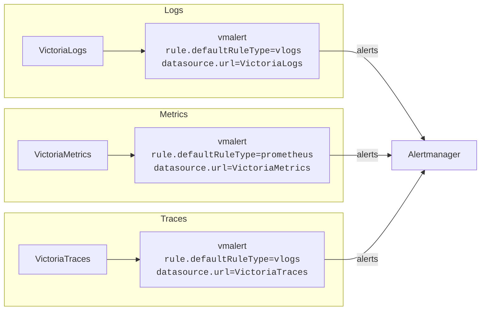
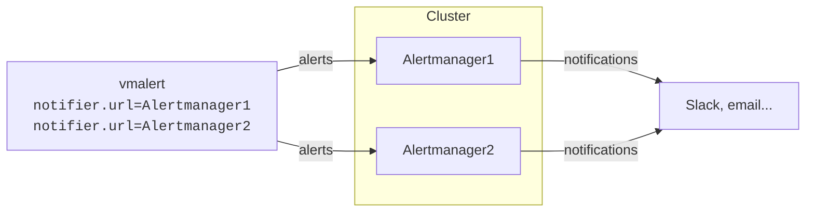

Alerting evaluates rules against metrics, logs, or traces and sends notifications when conditions are met. Common
examples include service outages, error messages in log entries, spikes in HTTP request rate, or slow traces.

In VictoriaStack, the [vmalert](https://docs.victoriametrics.com/victoriametrics/vmalert/) component acts as an alerting
engine. It integrates with [Alertmanager](https://github.com/prometheus/alertmanager), which dispatches the
notifications to destinations like [email, Slack, PagerDuty, or MS Teams](https://prometheus.io/docs/alerting/latest/integrations/#available-integrations).


Use a separate vmalert instance per signal. This keeps the rules configuration simpler and isolates the alerting
pipelines from each other. A single instance can also serve
[several signals at once](https://docs.victoriametrics.com/victorialogs/vmalert/#how-to-use-one-vmalert-for-victorialogs-and-victoriametrics-rules-at-the-same-time).


## Quick Start

Alerting needs three things:
1. A list of [rules](#rules) to execute.
2. A datasource URL to execute the rules against.
3. An Alertmanager URL to send notifications to.

vmalert is a single binary. Start it with the following command:
```sh
./path/to/vmalert \
    -rule=alert.rules \
    -datasource.url=http://victoriametrics:8428 \
    -notifier.url=http://alertmanager:9093 \
    -remoteWrite.url=http://victoriametrics:8428 \
    -remoteRead.url=http://victoriametrics:8428
```

* `-rule` - path to the file with rules configuration. Supports wildcards and HTTP URLs. S3 and GCS paths are available
  in Enterprise.
* `-datasource.url` - URL to query for rules evaluation.
* `-notifier.url` - Alertmanager URL to send notifications to.
* `-remoteWrite.url` - URL to write the results of [recording rules](#rules) and the state of alerts to. Required for
  recording rules, and for keeping the alert state across restarts.
* `-remoteRead.url` - URL to restore the alert state from on startup.

> See more detailed documentation in [vmalert Quick Start docs](https://docs.victoriametrics.com/victoriametrics/vmalert/#quickstart).

With the configuration above, vmalert periodically evaluates the rules from the `alert.rules` file against
`-datasource.url`, and sends notifications to `-notifier.url` when conditions are met.

The key features of vmalert are:
* Supports Prometheus [alerting rules syntax](https://prometheus.io/docs/prometheus/latest/configuration/alerting_rules/#defining-alerting-rules),
  making it easier to migrate from a Prometheus stack.
* Supports [recording rules](https://docs.victoriametrics.com/victoriametrics/vmalert/#recording-rules), allowing you to
  convert query results, logs and traces into metrics. Recording rules write their results to `-remoteWrite.url`.
* [Hot reload](https://docs.victoriametrics.com/victoriametrics/vmalert/#hot-config-reload) of configuration rules from S3, URL, or local file system.
* Persists [alert state across restarts](https://docs.victoriametrics.com/victoriametrics/vmalert/#alerts-state-on-restarts)
  when `-remoteWrite.url` and `-remoteRead.url` are set. Without them vmalert keeps the state in memory only, and a
  restart resets all active alerts.
* Supports recording and alerting rules backfilling (`replay`). See [these docs](https://docs.victoriametrics.com/victoriametrics/vmalert/#rules-backfilling) to learn more.

## Rules

vmalert reads [rules in yaml format](https://docs.victoriametrics.com/victoriametrics/vmalert/#groups) from the local
file system, a remote URL, or object storage. Every rule holds a query expression written in the query language of its
datasource. For example, the following alerting rule for VictoriaLogs triggers when a single pod in `env=prod` produces
more than 10 `error` or `warn` logs during the last 5 minutes:
```yaml
groups:
  - name: ServiceLog
    type: vlogs # The type is set to query VictoriaLogs
    interval: 5m
    rules:
      - alert: HasMoreThan10ErrorLogs
        expr: '{env="prod"} status:in(error,warn) | stats by (k8s.pod.name) count() as error_logs | filter error_logs:>10'
        annotations:
          description: 'Too big number of errors and warnings on pod {{ index .Labels "k8s.pod.name" }} during the last 5 minutes: {{$value}}'
```

The `type` field selects the query language for the whole group. Supported values are `prometheus` for MetricsQL and
PromQL (the default), `vlogs` for LogsQL, and `graphite`. Use `-rule.defaultRuleType` to change the default for all
groups. Rules for VictoriaTraces also use `type: vlogs`, because VictoriaTraces queries are written in LogsQL.
See rule examples for [logs](https://docs.victoriametrics.com/victorialogs/vmalert/)
and [traces](https://docs.victoriametrics.com/victoriatraces/vmalert/).

Every database ships production-ready rules for monitoring itself, so you don't have to write the rules for the stack
from scratch: see [Monitoring](https://docs.victoriametrics.com/victoriastack/deployment/#monitoring) for the recommended rules
and the Grafana dashboards that go with them.

## Datasource

The `-datasource.url` flag sets the address vmalert queries when it evaluates rules. It accepts a VictoriaMetrics,
VictoriaLogs, or VictoriaTraces URL, depending on the [type of integration](https://docs.victoriametrics.com/victoriametrics/vmalert/#integrations).



vmalert periodically executes the rules against the configured datasource and sends notifications to Alertmanager when
conditions are met.

## Alertmanager

[Alertmanager](https://prometheus.io/docs/alerting/latest/alertmanager/) is a component of the Prometheus project, not of
VictoriaStack. The stack integrates with it instead of shipping a notification service of its own, so existing
Alertmanager configurations, silences, and integrations keep working after a migration.

The `-notifier.url` flag sets the Alertmanager address vmalert notifies when a rule fires. Alertmanager then groups the
alerts, suppresses and silences them according to its configuration, and delivers the rest to destinations such as email
or Slack. See [Alertmanager docs](https://prometheus.io/docs/alerting/latest/alertmanager/) for more details.



> If you run a cluster of Alertmanager instances, list all of them in the `-notifier.url` flag, separated by comma.

vmalert can also discover Alertmanager via Consul or DNS service discovery.
See more details in [vmalert docs](https://docs.victoriametrics.com/victoriametrics/vmalert/#notifier-configuration-file).

## High Availability

One vmalert instance is enough for most installations. vmalert is stateless, it restarts within a few seconds, and a
restarted instance [restores the state of its alerts](https://docs.victoriametrics.com/victoriametrics/vmalert/#alerts-state-on-restarts).

Run two or more identically configured instances when alerting has to survive the loss of a single vmalert:

```mermaid
flowchart LR

    M["VictoriaMetrics<br/><code>dedup.minScrapeInterval=evalInterval</code>"]

    subgraph HA["HA vmalert"]
        direction LR

        V1["vmalert<br/><code>notifier.url=Alertmanager<br/>datasource.url=VictoriaMetrics</code>"]
        V2["vmalert<br/><code>notifier.url=Alertmanager<br/>datasource.url=VictoriaMetrics</code>"]
    end

    A["Alertmanager"]

    M -->|"queries"| V1
    M -->|"queries"| V2

    V1 -->|"alerts"| A
    V2 -->|"alerts"| A
 ```

Every instance evaluates the same rules, writes the results to the same destinations, and notifies the same
Alertmanagers. Two things to keep in mind:

* **The load on the datasource grows with the number of instances**, since each replica queries it for every rule.
* **Keep the configuration of the instances identical.** Alertmanager deduplicates alerts with identical labels, so
  instances configured differently produce separate alerts instead of duplicates of the same one.

When the instances persist the alert state or evaluate recording rules, that is when `-remoteWrite.url` is set,
configure [deduplication](https://docs.victoriametrics.com/victoriametrics/single-server-victoriametrics/#deduplication)
on the storage as well. Set `-dedup.minScrapeInterval` equal to vmalert's `-evaluationInterval`, so that the identical
results written by every instance collapse into a single data point.

See more details in [vmalert docs](https://docs.victoriametrics.com/victoriametrics/vmalert/#ha-vmalert).

## Scalability

vmalert is a lightweight service: it sends query requests to the datasource and alerts to Alertmanager, and does no
heavy lifting of its own. One instance handles thousands of rules on very few resources, so it rarely needs sharding.

When horizontal scaling is required, split the rules into separate files by group and run a vmalert instance per file.
