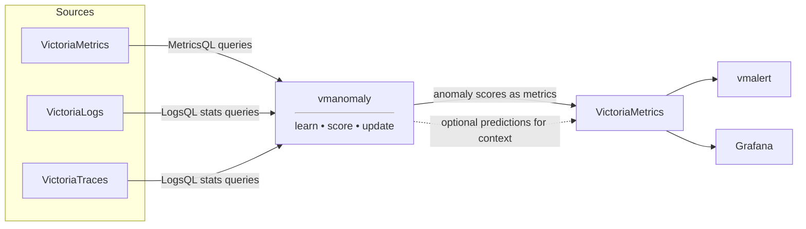

Static alerts are the right choice when a value is always unacceptable or an invariant must never be broken. Anomaly detection complements them when expected behavior depends on time, workload, trend, seasonality, scale, or relationships between signals.

[vmanomaly](https://docs.victoriametrics.com/anomaly-detection/) learns expected data behavior and writes a [unified anomaly score](https://docs.victoriametrics.com/anomaly-detection/faq/#what-is-anomaly-score) to VictoriaMetrics for contextual alerting and investigation. This reduces the engineering effort spent maintaining raw-value thresholds and gives [vmalert](https://docs.victoriametrics.com/victoriastack/alerting/) a stable, explicit decision boundary for contextual anomalies.

`vmanomaly` helps teams:

- reduce alert engineering and review effort across differently scaled signals;
- detect meaningful deviations in trending, seasonal, changing, or interconnected data;
- learn incrementally with [online models](https://docs.victoriametrics.com/anomaly-detection/components/models/#online-models) from a stream instead of repeatedly reading and refitting large history windows;
- quickly progress from a query to a validated configuration and starting alerting rules with the [UI](https://docs.victoriametrics.com/anomaly-detection/ui/) and available AI assistance.

> `vmanomaly` is part of [VictoriaMetrics Enterprise](https://docs.victoriametrics.com/victoriastack/enterprise/) and requires a license key. The VictoriaMetrics, VictoriaLogs, or VictoriaTraces data source can use either the Community or Enterprise edition and a single-node or clustered deployment. A [trial license](https://victoriametrics.com/products/enterprise/trial/) is available for evaluation.

## How it fits into VictoriaStack

`vmanomaly` runs alongside the VictoriaStack databases:



Metrics are queried directly from VictoriaMetrics. Logs and traces are analyzed as numeric time series returned by [LogsQL `stats` queries](https://docs.victoriametrics.com/victorialogs/logsql/#stats-pipe), such as error rates or span-duration aggregates.

[The results](https://docs.victoriametrics.com/anomaly-detection/components/models/#vmanomaly-output) are ordinary metrics in VictoriaMetrics, preserving all input labels and values. Existing tools can therefore evaluate alerting rules and visualize the observed values, expected behavior, and anomaly scores without a separate anomaly-specific backend.

## One operational signal

[`anomaly_score`](https://docs.victoriametrics.com/anomaly-detection/faq/#what-is-anomaly-score) provides a consistent operational signal across [models](https://docs.victoriametrics.com/anomaly-detection/components/models/):

- `0` means the observation matches the model expectation;
- values up to `1` remain within the expected range;
- values above `1` cross the default anomaly boundary.

The score is a continuous, de-scaled, de-trended and de-seasonalized value with an interpretable decision boundary at `1`.

A rule such as `anomaly_score > 1` can therefore be reused across CPU, latency, traffic, and business signals rather than maintaining a different raw-value threshold for each one.

The boundary at `1` is a stable starting point, not a substitute for operational validation. Teams can raise the alert threshold, require a duration, or aggregate scores to match the sensitivity and notification policy of a service.

[Univariate models](https://docs.victoriametrics.com/anomaly-detection/components/models/#univariate-models) produce scores for individual input series. [Multivariate models](https://docs.victoriametrics.com/anomaly-detection/components/models/#multivariate-models) can instead produce one joint score for a group of related series. Depending on the selected model and [output configuration](https://docs.victoriametrics.com/anomaly-detection/components/models/#provide-series), outputs can include the actual observed value (`y`), expected value (`yhat`), and prediction interval (`yhat_lower` and `yhat_upper`) for easier investigation and visualization.

## Online-first learning

Most built-in models support online learning. Their operating cycle is:

1. **Bootstrap** from enough historical behavior to establish an initial profile.
2. **Score and update** incrementally as new samples arrive.
3. **Persist and restore** the learned state so a restart does not require repeatedly querying and refitting the same history.

This spreads computation and data transfer over time and lets models adapt to new patterns without retraining from scratch. See the [online model lifecycle](https://docs.victoriametrics.com/anomaly-detection/components/models/#online-models) and [state restoration](https://docs.victoriametrics.com/anomaly-detection/components/settings/#state-restoration) for configuration details.

## Add domain knowledge

A statistically unusual value is not always operationally important. Stable business policies can be attached to each input query so they apply consistently when models change:

| Policy | Use it to |
|---|---|
| [`detection_direction`](https://docs.victoriametrics.com/anomaly-detection/components/models/#detection-direction) | Detect only values above expected, below expected, or in both directions. |
| [`data_range`](https://docs.victoriametrics.com/anomaly-detection/components/reader/#per-query-parameters) | Define values that are impossible or unacceptable for the signal. |
| [`min_dev_from_expected`](https://docs.victoriametrics.com/anomaly-detection/components/models/#minimal-deviation-from-expected) | Ignore deviations that are too small in absolute units to matter. |
| [`min_rel_dev_from_expected`](https://docs.victoriametrics.com/anomaly-detection/components/models/#minimal-relative-deviation-from-expected) | Ignore deviations that are too small relative to expected behavior. |
| [Multivariate grouping](https://docs.victoriametrics.com/anomaly-detection/components/models/#multivariate-models) | Detect changes in meaningful relationships between signals. |

For example, an error-rate query can reject negative values, detect only upward deviations, and ignore small percentage changes before they become anomaly alerts:

```yaml
reader:
  class: vm
  datasource_url: http://victoriametrics:8428
  sampling_period: 1m
  queries:
    error_rate:
      expr: 'sum(rate(http_requests_total{status=~"5.."}[5m]))'
      data_range: [0, 'inf']
      detection_direction: above_expected
      min_rel_dev_from_expected: [0, 20]
```

These controls encode the difference between mathematical deviation and business impact, reducing false positives and keeping detected profiles aligned with operational expectations. See all [per-query parameters](https://docs.victoriametrics.com/anomaly-detection/components/reader/#per-query-parameters).

## Get started

For predefined metric sets, [presets](https://docs.victoriametrics.com/anomaly-detection/presets/) provide a configuration, Grafana dashboard, and starting alerting rules. A minimal node-exporter setup specifies only the reader and writer endpoints:

```yaml
preset: node-exporter
reader:
  datasource_url: http://victoriametrics:8428
writer:
  datasource_url: http://victoriametrics:8428
```

For a custom signal, use the [built-in UI](https://docs.victoriametrics.com/anomaly-detection/ui/) to explore historical behavior, compare models, and backtest the resulting configuration. [AI Copilot](https://docs.victoriametrics.com/anomaly-detection/ui/#ai-assistance), [vmanomaly MCP server](https://github.com/VictoriaMetrics/mcp-vmanomaly), and [VictoriaMetrics agent skills](https://github.com/VictoriaMetrics/skills) can profile a query, suggest and fine-tune suitable models, and help produce a validated configuration plus starting alerting rules.

Then use the standard VictoriaStack workflow:

1. Write `anomaly_score` and optional prediction outputs to VictoriaMetrics.
2. Alert on the unified signal, starting with `anomaly_score > 1`.
3. Investigate alerts using [generic anomaly score dashboard](https://docs.victoriametrics.com/anomaly-detection/presets/#grafana-dashboard).
4. Tune duration, grouping, business filters, and routing as needed.

Follow the [quick start](https://docs.victoriametrics.com/anomaly-detection/quickstart/) for installation and the [vmalert integration guide](https://docs.victoriametrics.com/anomaly-detection/guides/guide-vmanomaly-vmalert/) for a complete example.

## Deployment and operations

`vmanomaly` supports the same deployment paths as other VictoriaStack components:

- [Docker](https://docs.victoriametrics.com/anomaly-detection/quickstart/#docker);
- [VictoriaMetrics Anomaly Helm chart](https://github.com/VictoriaMetrics/helm-charts/tree/master/charts/victoria-metrics-anomaly);
- [VMAnomaly custom resource](https://docs.victoriametrics.com/operator/resources/vmanomaly/) in VictoriaMetrics Operator.

For larger workloads, `vmanomaly` supports [horizontal scalability through sharding](https://docs.victoriametrics.com/anomaly-detection/scaling-vmanomaly/#horizontal-scalability) and [high availability through replication](https://docs.victoriametrics.com/anomaly-detection/scaling-vmanomaly/#high-availability) of validated sub-configurations across instances.

See [Deployment](https://docs.victoriametrics.com/victoriastack/deployment/) for the overall stack architecture. For production operation, see [scaling and high availability](https://docs.victoriametrics.com/anomaly-detection/scaling-vmanomaly/), [self-monitoring](https://docs.victoriametrics.com/anomaly-detection/self-monitoring/), and [multitenancy](https://docs.victoriametrics.com/anomaly-detection/components/writer/#multitenancy-support).
