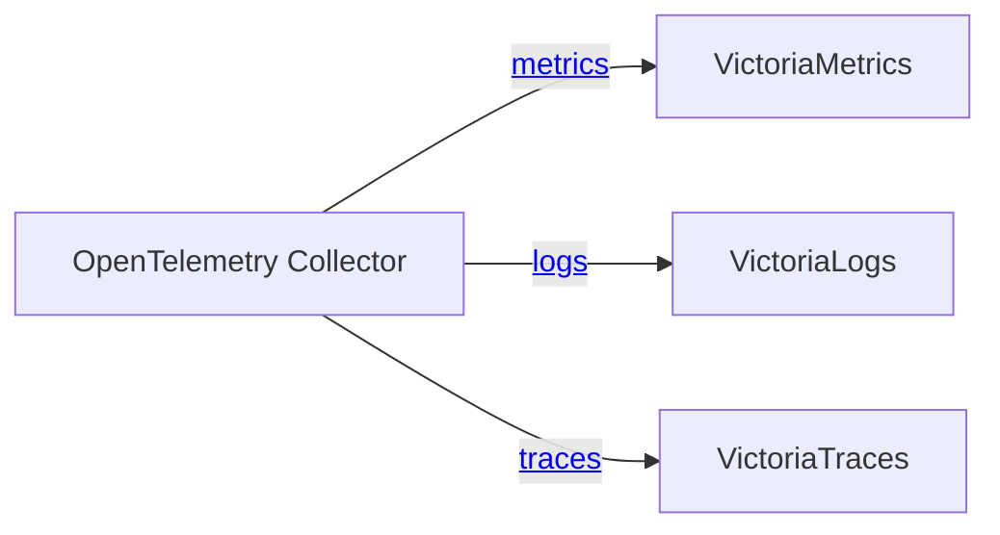
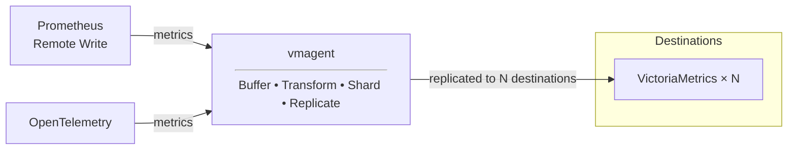
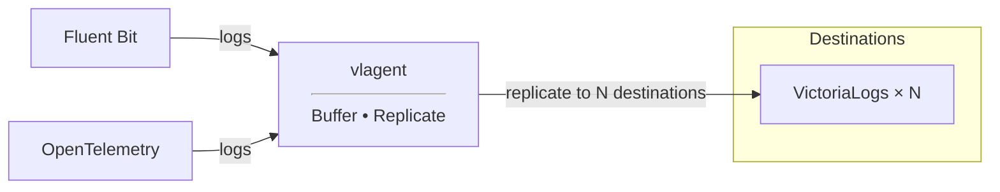
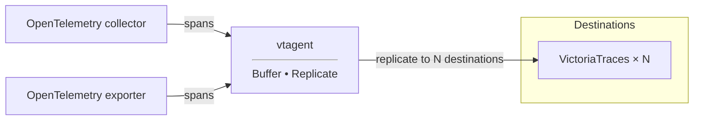

There are three ways to deliver data to VictoriaStack - pick the one that matches the pipeline you already have:

| Path                                            | Use it when                                                                                                                                    |
|-------------------------------------------------|------------------------------------------------------------------------------------------------------------------------------------------------|
| [OpenTelemetry Collector](#opentelemetry)       | you already collect telemetry with OpenTelemetry, or you start from scratch and want a single pipeline for all three signals                   |
| [Agents you already run](#agents-and-protocols) | you run Prometheus, Vector, Grafana Alloy, Fluent Bit, Telegraf and others can push to VictoriaStack directly                                  |
| [vmagent, vlagent, vtagent](#native-ingestion)  | you want reliable and cost-efficient delivery: high throughput, on-disk buffering, replication between installations, and traffic compression. |

<br>

**The paths combine**: OpenTelemetry Collector or a third-party agent can push to vmagent/vlagent/vtagent, which buffer the
data and forward it to the databases. That keeps the existing collection setup and still gets the delivery guarantees of
the native agents.

## OpenTelemetry

See the example of the OpenTelemetry Collector configuration below:

```yaml
receivers:
  otlp:
    protocols:
      grpc:
        endpoint: 0.0.0.0:4317

exporters:
  otlp_http/vmetrics: { metrics_endpoint: http://victoriametrics:8428/opentelemetry/v1/metrics }
  otlp_http/vlogs:    { logs_endpoint: http://victorialogs:9428/insert/opentelemetry/v1/logs }
  otlp_http/vtraces:  { traces_endpoint: http://victoriatraces:10428/insert/opentelemetry/v1/traces }

service:
  pipelines:
    logs:    { receivers: [ otlp ], exporters: [ otlp_http/vlogs ] }
    traces:  { receivers: [ otlp ], exporters: [ otlp_http/vtraces ] }
    metrics: { receivers: [ otlp ], exporters: [ otlp_http/vmetrics ] }
```

Here, OpenTelemetry Collector receives signals via the gRPC protocol,
and then forwards data to VictoriaStack via HTTP endpoints:
* `http://victoriametrics:8428/opentelemetry/v1/metrics` for metrics
* `http://victorialogs:9428/insert/opentelemetry/v1/logs` for logs
* `http://victoriatraces:10428/insert/opentelemetry/v1/traces` for traces



Each integration has tweaks you can apply. See the following docs for more details:
* [VictoriaMetrics OpenTelemetry Setup](https://docs.victoriametrics.com/victoriametrics/integrations/opentelemetry/)
* [VictoriaLogs OpenTelemetry Setup](https://docs.victoriametrics.com/victorialogs/data-ingestion/opentelemetry/)
* [VictoriaTraces OpenTelemetry Setup](https://docs.victoriametrics.com/victoriatraces/data-ingestion/opentelemetry/)

In the Quick Start we also [use OpenTelemetry Collector](https://github.com/VictoriaMetrics/VictoriaStack/blob/main/deployment/config/otelcollector/config.yml)
as example.

## Agents and protocols

VictoriaStack supports a wide range of ingestion protocols and agents:

| Signal      | Ingestion protocols                                                                                       | Agents                                           | Links                                                                    |
|-------------|-----------------------------------------------------------------------------------------------------------|--------------------------------------------------|--------------------------------------------------------------------------|
| **Metrics** | Prometheus `remote_write`, OpenTelemetry, InfluxDB line, Graphite, DataDog, OpenTSDB, JSON and CSV import | Prometheus, Grafana Alloy, Vector, Telegraf      | [docs](https://docs.victoriametrics.com/victoriametrics/data-ingestion/) |
| **Logs**    | OpenTelemetry, Elasticsearch bulk, Loki JSON, syslog, journald, DataDog, JSON stream                      | Fluent Bit, Filebeat, Logstash, Vector, Promtail | [docs](https://docs.victoriametrics.com/victorialogs/data-ingestion/)    |
| **Traces**  | OpenTelemetry                                                                                             | OpenTelemetry Collector                          | [docs](https://docs.victoriametrics.com/victoriatraces/data-ingestion/)  |

<br>

Keeping the agents you already run is the simplest way to start: nothing changes in how telemetry is collected, only
where it is sent. Follow the docs linked above when reconfiguring them, since some agents can have their own recommended
settings for endpoints, batching, compression, and retries.

For better delivery guarantees and ingestion pipeline control put a [native agent](#native-ingestion) between existing agents
and stack: vmagent/vlagent/vtagent support the same protocols, buffer the data on disk while a database is unavailable, 
and replicate it to several installations.

## Native ingestion

Support of various protocols and agents makes it easy to integrate VictoriaStack with existing installations. 
For improving cost-efficiency, high throughput, reliable on-disk buffering, replication, and traffic compression we 
recommend using native agents instead or together with existing agents:
- [vmagent](#vmagent) for metrics
- [vlagent](#vlagent) for logs
- [vtagent](#vtagent) for traces

### vmagent

[vmagent](https://docs.victoriametrics.com/victoriametrics/vmagent/) is an agent for collecting, receiving and forwarding
metrics to the specified destinations. Its core features are the following:
- [drop-in replacement for Prometheus](https://prometheus.io/): vmagent supports [Prometheus service discovery](https://docs.victoriametrics.com/victoriametrics/sd_configs/),
  [scraping configs](https://docs.victoriametrics.com/victoriametrics/scrape_config_examples/), [relabeling](https://docs.victoriametrics.com/victoriametrics/relabeling/)
- [on-disk buffering](https://docs.victoriametrics.com/victoriametrics/vmagent/#on-disk-persistence): stores unsent metrics
  on the local disk until the remote destination is available
- [replication](https://docs.victoriametrics.com/victoriametrics/vmagent/#replication-and-high-availability) and
  [sharding](https://docs.victoriametrics.com/victoriametrics/vmagent/#sharding-among-remote-storages): allows building
  highly available and horizontally scalable pipelines for metrics delivery
- [uses fewer resources](https://victoriametrics.com/blog/opentelemetry-prometheus-and-more/) than other agents for
  collecting and forwarding metrics. In a benchmark scraping 1200 node exporters, vmagent needed 3.2x less CPU and 2.7x
  less memory than the OpenTelemetry Collector, and 1.6x less CPU and 3.0x less memory than Prometheus 3.x

In addition to the features above, vmagent supports all the same ingestion protocols for metrics as VictoriaMetrics,
which makes it a perfect entry point in the delivery pipeline for metrics:


As an entry point, vmagent can [filter](https://docs.victoriametrics.com/victoriametrics/relabeling/#scraping-relabeling-cheatsheet),
[deduplicate](https://docs.victoriametrics.com/victoriametrics/vmagent/#flexible-deduplication),
[pre-aggregate](https://docs.victoriametrics.com/victoriametrics/stream-aggregation/), rate-limit ingested samples and
[limit cardinality](https://docs.victoriametrics.com/victoriametrics/vmagent/#cardinality-limiter).

The forwarded traffic is [additionally compressed](https://docs.victoriametrics.com/victoriametrics/vmagent/#victoriametrics-remote-write-protocol),
resulting in 2x-5x network bandwidth reduction. See the blog post [Save network costs with VictoriaMetrics remote write protocol](https://victoriametrics.com/blog/victoriametrics-remote-write/).

Use vmagent to make metrics delivery [highly available](https://docs.victoriametrics.com/victoriametrics/vmagent/#replication-and-high-availability).

### vlagent

[vlagent](https://docs.victoriametrics.com/victorialogs/vlagent/) is an agent for collecting logs from various sources
and forwarding them to the specified destinations. Its core features are the following:
- [collecting logs from K8s pods](https://docs.victoriametrics.com/victorialogs/vlagent/#collect-kubernetes-pod-logs):
  native support for collecting logs from Kubernetes Pods
- [on-disk buffering and replication](https://docs.victoriametrics.com/victorialogs/vlagent/#replication-and-high-availability):
  allows building highly available and scalable pipelines for logs delivery
- [uses fewer resources](https://victoriametrics.com/blog/log-collectors-benchmark-2026/) than other log collectors,
  which saves compute on collecting and delivering logs

In addition to the features above, vlagent supports all the same ingestion protocols for logs as VictoriaLogs,
which makes it a perfect entry point in the delivery pipeline for logs:


Use vlagent to make log delivery [highly available](https://docs.victoriametrics.com/victorialogs/#high-availability).

### vtagent

[vtagent](https://docs.victoriametrics.com/victoriatraces/vtagent/) is an agent for accepting trace spans from OTLP exporters
and forwarding them to the specified destinations. Its core feature is 
[on-disk buffering and replication](https://docs.victoriametrics.com/victoriatraces/vtagent/#replication-and-high-availability):
that allows building highly available and scalable pipelines for spans delivery.



## Cluster and multitenancy

Clustered databases accept data on their insert components: `vminsert`, `vlinsert`, and `vtinsert`:

| Signal      | Single-node URL                                              | Clustered URL                                          |
|-------------|--------------------------------------------------------------|--------------------------------------------------------|
| **Metrics** | `http://victoriametrics:8428/opentelemetry/v1/metrics`     | `http://vminsert:8480/insert/opentelemetry/v1/metrics` |
| **Logs**    | `http://victorialogs:9428/insert/opentelemetry/v1/logs`      | `http://vlinsert:9428/insert/opentelemetry/v1/logs`    |
| **Traces**  | `http://victoriatraces:10428/insert/opentelemetry/v1/traces` | `http://vtinsert:10428/insert/opentelemetry/v1/traces` |

<br>

A clustered installation runs multiple replicas of every insert component. Put [vmauth](https://docs.victoriametrics.com/victoriastack/access-control/)
in front of them to control access, balance the load, and expose a single ingestion endpoint:
```yaml
unauthorized_user:
  url_map:
    # VictoriaMetrics writes
    - src_paths: ["/metrics/insert/.*"]
      drop_src_path_prefix_parts: 1
      url_prefix:
        - "http://vminsert-1:8480"
        - "http://vminsert-2:8480"

    # VictoriaLogs writes
    - src_paths: ["/logs/insert/.*"]
      drop_src_path_prefix_parts: 1
      url_prefix:
        - "http://vlinsert-1:9428"
        - "http://vlinsert-2:9428"

    # VictoriaTraces writes
    - src_paths: [ "/traces/insert/.*" ]
      drop_src_path_prefix_parts: 1
      url_prefix:
        - "http://vtinsert-1:10428"
        - "http://vtinsert-2:10428"
```

With the configuration above, vmauth accepts write requests on a single endpoint and balances them across the replicas:
* `http://vmauth:8427/metrics/insert/*` for metrics,
* `http://vmauth:8427/logs/insert/*` for logs,
* `http://vmauth:8427/traces/insert/*` for traces.

The [clustered demo](https://github.com/VictoriaMetrics/VictoriaStack/blob/main/deployment/config/vmauth/cluster.yml) runs
exactly this vmauth configuration, and its
[OpenTelemetry Collector](https://github.com/VictoriaMetrics/VictoriaStack/blob/main/deployment/config/otelcollector/config.yml)
writes to these endpoints.

**Tenants are specified with HTTP headers** in the same way in all three databases. Set `AccountID` and `ProjectID` on the
write request, for example in an OpenTelemetry Collector exporter:

```yaml
exporters:
  otlp_http/vlogs: { logs_endpoint: http://vmauth:8427/logs/insert/opentelemetry/v1/logs, headers: { AccountID: "0", ProjectID: "0" } }
```

Requests without these headers write to the default tenant `0:0`.

> Note: VictoriaMetrics supports [multitenancy](https://docs.victoriametrics.com/victoriastack/multitenancy/) only in the cluster mode.

Once the data arrives, see [Querying](https://docs.victoriametrics.com/victoriastack/querying/) for the query languages and APIs of
every signal, and [UI integrations](https://docs.victoriametrics.com/victoriastack/ui/) for building dashboards on top of them.
